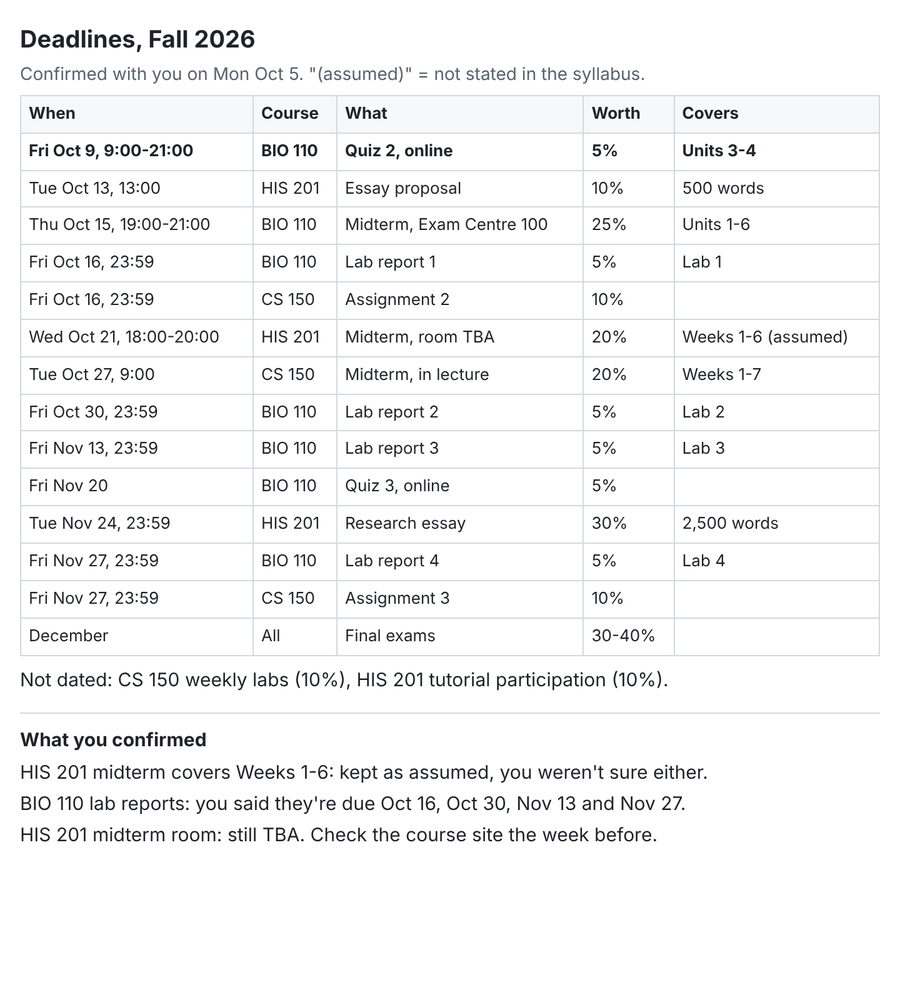
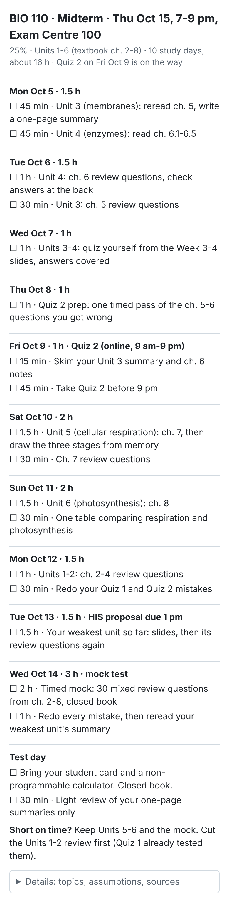

# semester-autopilot

A Claude skill that plans a student's semester. Upload your syllabuses, check one table of every test and deadline, and get a short study plan per course, a weekly schedule and a calendar file.

It works with any school. Optional **Power mode** also downloads every file from your course site (Canvas, Moodle, Brightspace, Blackboard) into one folder per course. The worked example is the University of Toronto's Quercus.

  
  

## How it works
1. **Upload your syllabuses** to a claude.ai chat. No install beyond the skill itself.
2. **Confirm your deadlines.** Claude shows one table and marks anything it had to guess. Nothing gets planned on dates you haven't checked.
3. **Get your plans.** One per course, as a day-by-day checklist that fits on a phone screen, plus a combined weekly schedule and an `.ics` file you can import into a separate calendar.

## Install (2 minutes)
1. Download this repository as a zip (**Code > Download ZIP**).
2. In claude.ai, open **Settings > Capabilities**, turn on Skills, and upload the zip.
3. Open a new chat, attach your syllabuses, and say: *"Set up my semester. I'm at <school>, term <term>."*

Full steps, including Power mode, are in [SETUP.md](SETUP.md). Want to try it first? Use the [sample school](examples/sample-university/README.md).

## What's here
- `SKILL.md`: the instructions Claude follows.
- `SETUP.md`: setup steps for students, Basic and Power mode.
- `references/`: templates for the deadline table, study plans, the weekly schedule and the folder layout, plus notes for each course site.
- `examples/sample-university/`: a made-up school with three syllabuses and example output.
- `app/`: the web app (Next.js).

## Web app
[`app/`](app/) is an early web version of the first two steps: upload your syllabuses, confirm the deadline table, then download `deadlines.md` and an `.ics` file. It needs no account or API key, and your data stays in your browser. Study plans are still skill-only. To run or deploy it, see [`app/README.md`](app/README.md).

## Safety
Claude never asks for or types your password. You log in to your course site and library yourself. Textbooks come only from your library's licensed access or official open textbooks. Nothing in your folders is deleted or overwritten without your OK.

## License and credit
Licensed under [CC BY-NC 4.0](LICENSE). It's free for students and anyone else to use, share and adapt, as long as you credit the author and don't use it commercially. For commercial use, contact the author through GitHub. Suggested credit:

> "Semester Autopilot" by Jaspyplayz (https://github.com/Jaspyplayz/semester-autopilot), licensed under CC BY-NC 4.0.
