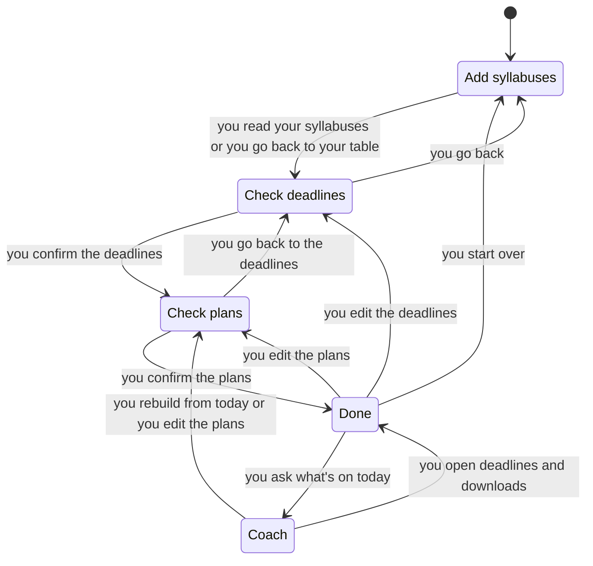

# Step flow model

A TLA+ model of how the app moves between its five steps, checked with TLC. It found three real bugs, listed below.

## What's modeled

Every button that changes the step, reloading the page, and "Read with Claude" and the course site import while they're in flight. Deadlines are two stand-ins, `A` and `B`, because only whether they match matters.

| Code | Model |
|---|---|
| `app/src/lib/state.ts` | `startDraft`, `confirmDraft`, `rebuildPlans`, `confirmPlans`, `openCoach`, `reviveState` |
| `app/src/lib/store.ts` | `Reload`, `StartOver` |
| `app/src/components/AutopilotApp.tsx` | `ScreensHaveData` |
| `app/src/components/InputStep.tsx`, `CanvasConnect.tsx` | The input step's actions and the reads in flight |
| `ConfirmStep.tsx`, `PlanStep.tsx`, `DoneStep.tsx`, `CoachStep.tsx` | One section each |

Last confirmed against the code at commit `950fb93`. If you change these files, check the model still describes them, then move this commit forward.

## Rules

These hold over all 15,024 reachable states:

- `ScreensHaveData`: no step renders blank because its data is missing.
- `CoachOnlyOnConfirmedPlans`: Coach only shows plans the student confirmed.
- `NoBlanksPastPlans`: no empty study block gets past the plans step.
- `PlansMatchDeadlines`: plans are always built on the confirmed deadlines.
- `ConfirmedPlansExist`: plans marked confirmed are never missing.

These break today. Each path is TLC's shortest, and `app/src/components/AutopilotApp.flow.test.ts` replays each one through the real app:

- `BadTimeZoneStaysOnInput`: the student never leaves the input step with a bad time zone. The course site import has no such check. Type a bad zone, press Get deadlines, and it opens Check deadlines. Done then crashes, because `buildIcs` throws.
- `LateReadKeepsWork`: a read doesn't overwrite work done since it started. Press Get deadlines, then Read deadlines, then edit the table. The import lands and replaces the table. It can also land on Done, and then it wipes the confirmed deadlines and plans.
- `StartOverStaysCleared`: Start over stays cleared. Press Get deadlines, then Read deadlines, confirm through to Done, and press Start over. The import lands and puts the syllabus and deadlines back in localStorage.

## What's left out

- Upload and sample loading, which also finish late but only add sources. A late one after Start over would put a source back too.
- Two tabs on the same localStorage, and the date changing overnight.
- What's in a table or plan. Whether a row is valid is `parse.ts` and `planner.ts`, covered by their tests.
- Two reads of the same kind at once. The code can do this after going back to the input step, because its busy flag is lost. The model allows one of each.
- Whether the student can always reach Done. TLC checks that no state is a dead end, not that every state leads there.

## Run it

Needs bash, curl and Java 11 or later. It downloads the pinned `tla2tools.jar` and verifies its checksum, or uses `TLA2TOOLS` if set.

```sh
verification/autopilot-steps/check.sh
```

It takes about 15 seconds, and CI runs it in `.github/workflows/verification.yml`. It only reads `AutopilotSteps.tla`, so it guards the model, not the app: no change to the app can turn it red. It goes red in three cases:

- A rule that holds breaks in the model.
- A broken copy of the model gets past its rule. Each rule has at least one such copy, listed in `MUTANTS`.
- A known bug stops breaking in the model. When you fix one in the app, change the model to match, move the rule to `HOLDS` in `check.sh`, and change its `knownBug` test to `it`.

Nothing checks the model against the app automatically. That's down to review, using the table above, and the pinned tests, which go red when a bug is fixed or its path through the app changes.

To see a path or redraw the chart, run pstack's `/statechart` on `AutopilotSteps.tla` with `view.mjs`. Use `AutopilotSteps.cfg` for the bug paths and `Flow.cfg` for the chart below.

## The flow

With no reads in flight, every rule holds over 200 states. Reloading never moves the student here, and editing or rebuilding stays on the same step, so neither gets an arrow.


